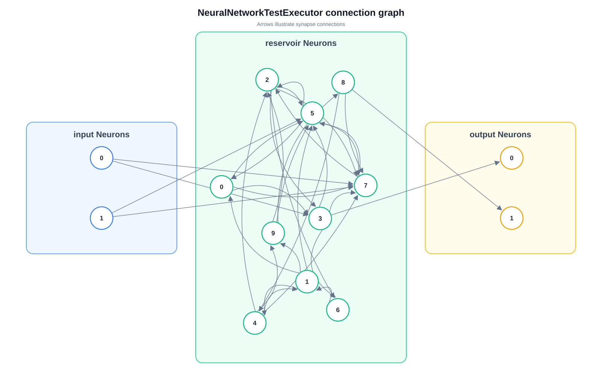

# Spiking Neural Networks with Variational Optimization

## test1.cpp
### architecture and data
Here I've hard coded the following reservoir architecture:

So I'll try to use this highly recurrent snn as a sequence classifier this toy data:
")
")
This data is transformed into a sequence of two dimensional data points where one dimension siginifies the normalized x-value of the pen, and the other dimension is the y-value.
When receiving the first example, which is a seven (7) being drawn, it should output one class and the other class on recveiving a one (1) being drawn.
### optimizing
Since it would be hard to trace a gradient through time in this recurrent (and pretty chaotic) network and since the gradient would be non-continuous thanks to the spiking nature of snns I'll use variation optimization in order to optimize this problem.
#### parameters
for each Leaky Integrate and Fire Neuron I have 3 learnable parameters:
- Membrane threshold
- Membrane volage decay
- Spike strength
#### variational optimization
say I sample from a distribution $p(x\vert \theta)$ so as to create pertubations on my parameters. This way I can create a population of snns that I can evaluate. Then with some clever math you can show that


$$
\frac{\partial}{\partial \theta} \mathbb{E}_{x\sim p(x\vert \theta)} f(x) =
\mathbb{E}_{x\sim p(x\vert \theta)} f(x) \frac{\partial}{\partial \theta} \log p(x\vert \theta)
$$


This way, evaluating a population of snns sampled from a known distribution, I can approximate the gradient of that very distribution by my snns' loss function. I.e., I can make gradient descent on how I sample my population in order to find an optimal population of snns. The mean (or median) of that population should be my optimal snn as well. Let's try it!
If I sample my population pertubations from the normal distribution:

$$
\mathcal{N}(\mu,\sigma^2) = \frac{1}{\sqrt{2\pi\sigma^2}}e^{\frac{-(x-\mu)^2}{2\sigma^2}}
$$


I can, from that first formula derive the update rule for $\mu$ and $\sigma$ to be:

$$
\frac{\partial\mathcal{N}}{\partial\mu} = \frac{1}{N}\displaystyle\sum{loss_i\frac{\epsilon_i}{\sigma^2}}
$$
$$
\frac{\partial\mathcal{N}}{\partial\sigma} = \frac{1}{N}\displaystyle\sum{loss_i(\frac{\epsilon_i^2}{\sigma^2} - 1)}
$$

where $\N$ is my population size and $\epsilon$ are my pertubations.

### results
Running this program yields the following terminal output:
```
Starting up...
                                                                             * 77.1315
                                                                            * 76.4242
                                                                            * 76.6168
                                                                             * 77.1787
                                                                           * 75.6754
                                                                            * 76.2781
                                                                          * 74.8312
                                                                           * 75.1703
                                                                         * 73.4205
                                                                          * 74.0688
                                                                        * 72.1521
                                                                        * 72.5472
                                                                       * 71.5222
                                                                      * 70.7639
                                                                       * 71.6322
                                                                      * 70.2875
                                                                     * 69.6604
                                                                     * 69.8997
                                                                   * 67.6541
                                                                     * 69.3713
                                                                   * 67.9759
                                                                   * 67.3612
                                                                  * 66.9444
                                                                 * 65.928
                                                                  * 66.2186
                                                                   * 67.1731
                                                                * 64.1572
                                                                 * 65.325
                                                                 * 65.1084
                                                               * 63.5286
                                                               * 63.1011
                                                                * 64.1594
                                                              * 62.1904
                                                              * 62.4025
                                                             * 61.2954
                                                             * 61.4756
                                                            * 60.5985
                                                            * 60.4614
                                                           * 59.9107
                                                           * 59.1896
                                                           * 59.6685
                                                          * 58.6282
                                                          * 58.7602
                                                         * 57.6078
                                                         * 57.1876
                                                         * 57.5384
                                                        * 56.9225
                                                        * 56.7046
                                                        * 56.2643
                                                       * 55.9556
                                                      * 54.3422
                                                      * 54.7331
                                                     * 53.7904
                                                      * 54.2275
                                                     * 53.7362
                                                     * 53.6231
                                                   * 51.7952
                                                    * 52.4318
                                                    * 52.0876
                                                    * 52.0858
                                                   * 51.6598
                                                   * 51.1166
                                                  * 50.9322
                                                 * 49.9957
                                                  * 50.6171
                                                * 48.8862
                                                 * 49.3484
                                                * 48.6311
                                                * 48.6039
                                                * 48.0561
                                               * 47.7872
                                               * 47.5473
                                              * 46.2362
                                               * 47.2979
                                             * 45.6956
                                             * 45.7258
                                             * 45.4962
                                             * 45.3677
                                            * 44.4595
                                             * 45.1003
                                            * 44.0751
                                           * 43.7868
                                           * 43.4755
                                          * 42.8794
                                           * 43.3502
                                          * 42.3575
                                          * 42.7234
                                          * 42.5849
                                         * 41.6265
                                         * 41.4034
                                         * 41.2016
                                        * 40.7311
                                         * 41.129
                                       * 39.9729
                                       * 39.6235
                                       * 39.7086
                                       * 39.7416
                                       * 39.328
                                       * 39.0195
                                      * 38.5392
                                      * 38.1056
```
which means that we are definately fitting this network to the data.